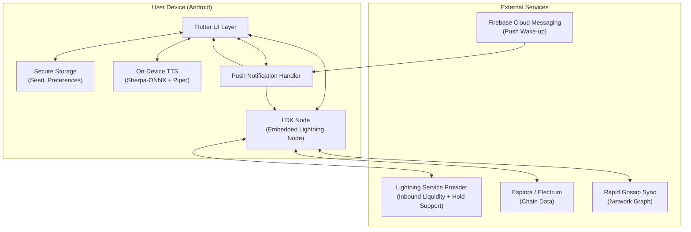
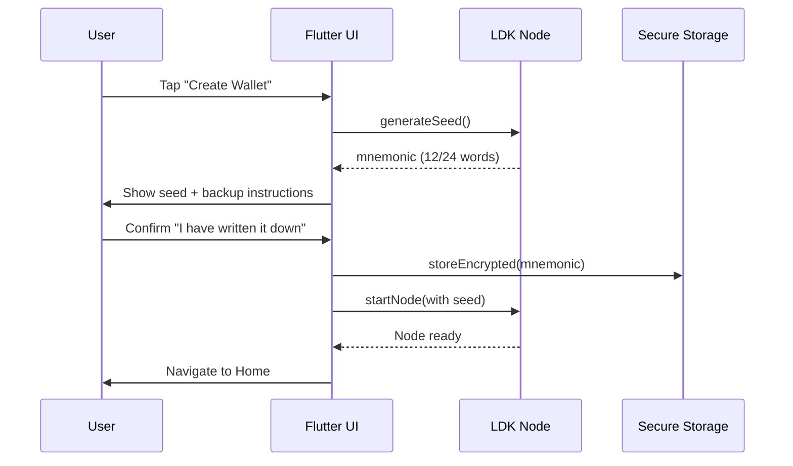
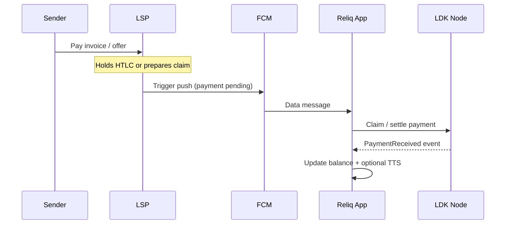
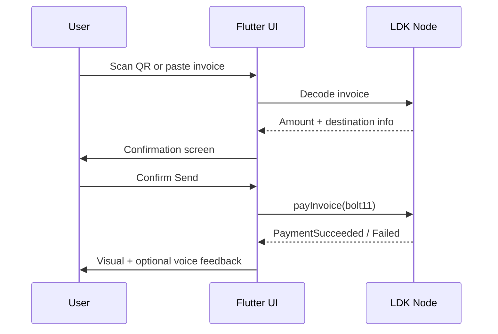

# Reliq — Technical Implementation Guide

**Version:** 1.0  
**Date:** 19 October 2026  
**Status:** Source of Truth for Implementation  
**Related Documents:** Project Foundation, Software Requirements Specification (SRS)

This document is the complete technical blueprint for building Reliq. It is written so that a human developer or an AI coding agent can follow it phase by phase and produce a working system. Every major decision, diagram, directory layout, integration point, and testing expectation is recorded here.

---

## Table of Contents

1. [Goals and Constraints](#1-goals-and-constraints)
2. [High-Level Architecture](#2-high-level-architecture)
3. [Technology Stack](#3-technology-stack)
4. [Project Directory Structure](#4-project-directory-structure)
5. [Core Components Deep Dive](#5-core-components-deep-dive)
6. [Data Flows and Communication](#6-data-flows-and-communication)
7. [UI Structure and Example Screens](#7-ui-structure-and-example-screens)
8. [Use Case Scenarios](#8-use-case-scenarios)
9. [Security and Key Management](#9-security-and-key-management)
10. [Offline / Intermittent Connectivity Strategy](#10-offline--intermittent-connectivity-strategy)
11. [Voice Layer (On-Device TTS)](#11-voice-layer-on-device-tts)
12. [Testing Strategy](#12-testing-strategy)
13. [Implementation Phases](#13-implementation-phases)
14. [Risks and Mitigations](#14-risks-and-mitigations)
15. [Appendix](#15-appendix)

---

## 1. Goals and Constraints

### Primary Goals
- Deliver a self-custodial Lightning mobile wallet whose core engine is **LDK / LDK Node**.
- Provide an extremely simple user interface suitable for users with limited digital literacy.
- Support receiving payments under intermittent connectivity.
- Offer on-device offline voice feedback in English and Hausa (where models allow).
- Remain fully non-custodial: the development team never holds spending keys.

### Hard Constraints
- LDK must be the Lightning implementation (Buildathon requirement).
- No custodial recovery path (no “recover with phone number only”).
- MVP must be demonstrable within the Buildathon timeline.
- Android is the primary target platform.

### Success Definition for MVP
A judge or mentor can:
1. Create a wallet and back up the seed.
2. Generate a receive QR / identifier.
3. Receive a payment (including a simulated intermittent-connectivity case).
4. Send a payment.
5. Hear spoken balance / payment confirmation.
6. Restore the wallet on a second device using only the seed.
7. See clear evidence that LDK is the core engine and that keys never leave the device.

---

## 2. High-Level Architecture



### Architectural Principles
1. **LDK is the source of truth** for all payment state, channel state, and key material.
2. The Flutter layer is a thin, highly usable shell around LDK.
3. No server stores private keys or can spend funds.
4. Optional encrypted backups are always under user control.
5. Voice is an accessibility layer, not a required path for core actions.

---

## 3. Technology Stack

| Layer | Technology | Notes |
|-------|------------|-------|
| Mobile Framework | Flutter (Dart) | Primary UI framework. Fast iteration, good performance, excellent for simple large-button interfaces. |
| Lightning Engine | LDK + LDK Node (Rust) | Mandatory core. Embedded via FFI / platform channels. |
| On-chain Wallet | BDK (integrated via LDK Node) | Handles on-chain UTXOs and seed derivation. |
| Chain Backend | Esplora (preferred) or Electrum | Lightweight chain data. |
| Gossip | Rapid Gossip Sync (RGS) | Efficient network graph for mobile. |
| LSP | Any LSPS2-compatible or custom LSP | Required for practical inbound liquidity and intermittent receive. |
| Secure Storage | `flutter_secure_storage` | Seed and sensitive preferences. |
| Push Notifications | Firebase Cloud Messaging | Wake app when payment can be claimed. |
| On-Device TTS | Sherpa-ONNX + Piper models | Fully offline after model download. English strong; Hausa best-effort. |
| Local Database | SQLite (via LDK Node persistence + optional Drift/Sembast for app metadata) | Channel state lives inside LDK Node. |
| QR Handling | `mobile_scanner` + `qr_flutter` | Scan and display. |
| State Management | Riverpod or Bloc | Predictable state for payment UI. |

### Language Split
- **Dart** — All UI, navigation, voice triggers, push handling, secure storage orchestration.
- **Rust** — LDK Node itself (compiled to native library and called via FFI or platform channel).

---

## 4. Project Directory Structure

```text
reliq/
├── README.md
├── pubspec.yaml
├── analysis_options.yaml
├── android/
├── ios/                          # Secondary target
├── lib/
│   ├── main.dart
│   ├── app.dart
│   ├── core/
│   │   ├── constants/
│   │   ├── errors/
│   │   ├── theme/
│   │   └── utils/
│   ├── data/
│   │   ├── ldk/
│   │   │   ├── ldk_node_service.dart      # FFI / platform channel wrapper
│   │   │   ├── ldk_events.dart
│   │   │   └── ldk_models.dart
│   │   ├── tts/
│   │   │   ├── tts_service.dart
│   │   │   └── voice_prompts.dart
│   │   ├── storage/
│   │   │   └── secure_storage_service.dart
│   │   └── push/
│   │       └── push_service.dart
│   ├── domain/
│   │   ├── entities/
│   │   ├── repositories/
│   │   └── usecases/
│   ├── presentation/
│   │   ├── screens/
│   │   │   ├── onboarding/
│   │   │   │   ├── welcome_screen.dart
│   │   │   │   ├── create_wallet_screen.dart
│   │   │   │   ├── backup_seed_screen.dart
│   │   │   │   └── restore_wallet_screen.dart
│   │   │   ├── home/
│   │   │   │   └── home_screen.dart
│   │   │   ├── receive/
│   │   │   │   └── receive_screen.dart
│   │   │   ├── send/
│   │   │   │   └── send_screen.dart
│   │   │   ├── balance/
│   │   │   │   └── balance_screen.dart
│   │   │   ├── activity/
│   │   │   │   └── activity_screen.dart
│   │   │   └── settings/
│   │   │       └── settings_screen.dart
│   │   ├── widgets/
│   │   │   ├── large_action_button.dart
│   │   │   ├── balance_display.dart
│   │   │   ├── payment_tile.dart
│   │   │   └── voice_button.dart
│   │   └── providers/                 # Riverpod / Bloc
│   └── l10n/                          # Localization strings
├── native/                            # Rust LDK Node bridge (if custom)
│   ├── Cargo.toml
│   └── src/
│       └── lib.rs
├── assets/
│   ├── models/                        # TTS models (downloaded or bundled)
│   └── images/
├── test/
├── integration_test/
└── docs/
    ├── architecture.md
    └── api_contracts.md
```

This structure separates:
- Presentation (UI)
- Domain (business rules)
- Data (LDK, TTS, storage, push)
- Native bridge (Rust)

---

## 5. Core Components Deep Dive

### 5.1 LDK Node Service

Responsibilities:
- Initialise LDK Node with network (testnet / signet / mainnet), Esplora URL, RGS URL.
- Generate or restore BIP39 mnemonic.
- Open / manage channels (usually via LSP).
- Create invoices / offers.
- Pay invoices.
- Emit events (payment received, payment failed, channel ready, etc.).
- Persist channel state.

Key interface (conceptual):

```dart
abstract class LdkNodeService {
  Future<void> init({required Network network, required String esploraUrl, required String rgsUrl});
  Future<String> generateSeed();                    // returns mnemonic
  Future<void> restoreFromSeed(String mnemonic);
  Future<String> getBalanceSats();
  Future<String> createInvoice({required int amountSats, String? description});
  Future<void> payInvoice(String bolt11);
  Stream<LdkEvent> get events;
  Future<void> stop();
}
```

### 5.2 Secure Storage Service

- Stores the BIP39 mnemonic only after the user has completed the backup confirmation flow.
- Stores user preferences (language, voice enabled/disabled).
- Uses platform keychain / keystore via `flutter_secure_storage`.

### 5.3 TTS Service

- Loads Sherpa-ONNX + Piper models from local storage.
- Exposes simple methods: `speakBalance(amount)`, `speakPaymentReceived(amount)`, `speakPaymentSent(amount)`, `speakError(message)`.
- Respects current language setting (en / ha).
- Falls back gracefully if model for a language is missing.

### 5.4 Push Service

- Registers device token with FCM.
- On receiving a data message that indicates a payment is ready to claim, wakes the relevant LDK logic and refreshes UI.

---

## 6. Data Flows and Communication

### 6.1 Wallet Creation Flow



### 6.2 Receive Payment (Intermittent Connectivity)



### 6.3 Send Payment Flow



---

## 7. UI Structure and Example Screens

### Primary Navigation Model
Single main screen with four large action areas + a small settings access point.

```
┌─────────────────────────────────────┐
│  Reliq                    [⚙]       │
├─────────────────────────────────────┤
│                                     │
│         Balance: 12,450 sats        │
│         (tap to hear)               │
│                                     │
│  ┌─────────────┐  ┌─────────────┐   │
│  │             │  │             │   │
│  │   RECEIVE   │  │    SEND     │   │
│  │             │  │             │   │
│  └─────────────┘  └─────────────┘   │
│                                     │
│  ┌─────────────┐  ┌─────────────┐   │
│  │  ACTIVITY   │  │   VOICE     │   │
│  │             │  │  (toggle)   │   │
│  └─────────────┘  └─────────────┘   │
│                                     │
└─────────────────────────────────────┘
```

### Screen List
1. **Welcome** — Create or Restore
2. **Backup Seed** — Guided, forced confirmation
3. **Home** — Four large actions + balance
4. **Receive** — QR + copyable identifier + optional amount
5. **Send** — Scanner + paste field + confirmation
6. **Activity** — Simple chronological list
7. **Settings** — Language, voice on/off, show seed (with warnings), network info

### Design Rules
- Minimum touch target 48–56 dp.
- High contrast.
- Almost no nested navigation for core flows.
- Every critical success/failure state has both visual and optional voice feedback.

---

## 8. Use Case Scenarios

### UC-01: First-Time User Creates Wallet
1. User opens app → Welcome screen.
2. Taps “Create New Wallet”.
3. App generates seed via LDK and displays it.
4. User is forced through a confirmation that they have recorded the seed.
5. Seed is stored in secure storage.
6. Node starts. User lands on Home screen.

### UC-02: Market Seller Receives Payment
1. Seller opens Receive screen.
2. Shows QR / Lightning Address to customer.
3. Customer pays from any Lightning wallet.
4. Even if seller’s phone was in pocket with intermittent data, push + LDK claim path delivers the payment.
5. Balance updates. Optional Hausa/English voice says “Payment received: X sats”.

### UC-03: User Sends Payment
1. User taps Send.
2. Scans QR or pastes invoice.
3. Confirms amount and destination.
4. LDK pays the invoice.
5. Success or failure is shown and optionally spoken.

### UC-04: Phone Lost — Recovery
1. User installs Reliq on new phone.
2. Chooses “Restore Wallet”.
3. Enters the 12/24-word seed.
4. LDK restores keys and channel state (to the extent possible with available backups and chain data).
5. User regains access to funds without any third party having held the keys.

### UC-05: Voice-Only Balance Check
1. User enables voice in Settings and selects Hausa or English.
2. On Home screen taps the balance area (or dedicated voice button).
3. On-device TTS speaks the current balance offline.

---

## 9. Security and Key Management

- Entropy for seed generation comes from LDK / secure system sources.
- Mnemonic is shown only during the backup flow and then stored encrypted.
- No analytics or crash reporting may include seed material or private keys.
- Optional cloud backup must be encrypted with a key derived from a user-chosen secret or device biometrics; the Reliq backend never receives plaintext seeds.
- Channel state is persisted by LDK Node using its own secure mechanisms.
- The application never implements a path where the development team can move user funds.

---

## 10. Offline / Intermittent Connectivity Strategy

Because full LDK Async Payments are still maturing, the MVP uses a pragmatic combination:

1. **LDK Node** runs on device and owns keys and channel state.
2. An **LSP** provides inbound liquidity and can hold HTLCs or assist with claim paths when the device is temporarily unreachable.
3. **Push notifications** wake the app so it can complete settlement when connectivity returns.
4. The UI remains usable offline for viewing last-known balance, generating a new receive identifier (when possible), and preparing a send (actual payment requires connectivity).

This approach stays self-custodial while delivering the reliability required for real-world informal-economy use.

---

## 11. Voice Layer (On-Device TTS)

### Technology
- **Sherpa-ONNX** as the inference engine.
- **Piper** (or compatible VITS) models for speech synthesis.
- Models downloaded once and stored locally.

### Supported Languages (MVP)
- English — high quality, readily available.
- Hausa — best available open model; quality may be lower. Document the limitation and treat improvement as post-MVP.

### Integration Points
- Balance screen / balance tap.
- Payment received event.
- Payment sent event.
- Selected error states.

Voice is always optional and can be toggled in Settings.

---

## 12. Testing Strategy

### Unit Tests
- LDK service wrapper (mocked native side).
- TTS service (mocked engine).
- Secure storage read/write.
- Invoice parsing and validation logic.
- State management (providers / blocs).

### Widget / UI Tests
- Home screen layout and button presence.
- Backup seed confirmation flow.
- Receive screen QR rendering.
- Send confirmation dialog.

### Integration Tests
- Full create-wallet → backup → home flow.
- Restore-from-seed flow.
- Simulated payment received event → balance update + TTS trigger.
- Send payment happy path (against regtest / signet).

### Manual / Demo Checklist
- Create wallet and record seed.
- Receive a real or regtest payment.
- Send a payment.
- Toggle voice and hear balance in English.
- Restore on second device/emulator using seed.
- Confirm no private key material appears in logs.

### Test Networks
- Prefer Signet or Mutinynet for development.
- Mainnet only after thorough testing and with small amounts.

---

## 13. Implementation Phases

The work is divided into strictly sequential phases. Each phase produces a demonstrable increment and can be handed to an AI coding agent as a self-contained goal.

### Phase 1 — Foundation & Wallet Lifecycle
**Goal:** A runnable Flutter app that can create, back up, and restore a BIP39 wallet using LDK Node, and display a basic home screen.

Deliverables:
- Flutter project skeleton with the directory structure above.
- LDK Node integrated via FFI or platform channel (minimum: generate seed, restore seed, start node, report balance).
- Secure storage of mnemonic.
- Onboarding screens: Welcome, Create, Backup (with confirmation), Restore.
- Empty Home screen with placeholder balance.
- Unit tests for seed generation and restoration paths.

Exit criteria: User can create a wallet, write down the seed, kill the app, restore on the same or another emulator, and see a zero balance.

---

### Phase 2 — Receive & Basic Send
**Goal:** Ability to generate a receive identifier and pay an invoice.

Deliverables:
- Receive screen with QR and copyable string (BOLT11 or Lightning Address style).
- Send screen with QR scanner and paste field.
- Confirmation dialog before sending.
- LDK invoice creation and payment execution.
- Basic activity list (in-memory or simple local persistence).
- Event handling for PaymentReceived and PaymentSucceeded/Failed.

Exit criteria: Two emulators (or emulator + real node) can pay each other on signet/regtest. Balance updates correctly.

---

### Phase 3 — Intermittent Connectivity & Push
**Goal:** Payments can still be claimed when the app was not in the foreground or had temporary connectivity loss.

Deliverables:
- Integration with an LSP (or mock LSP) that supports held payments or claim notification.
- Firebase Cloud Messaging (or equivalent) setup.
- Push handler that wakes LDK claim logic.
- UI indication of “payment pending / claiming”.
- Documentation of the exact LSP configuration used for the demo.

Exit criteria: A payment sent while the receiving app is backgrounded or briefly offline is successfully claimed after the app is woken by push or by the user re-opening the app.

---

### Phase 4 — Voice Layer & Polish
**Goal:** On-device TTS working for key events and overall UI polished for demo.

Deliverables:
- Sherpa-ONNX + Piper integration.
- English voice prompts for balance, payment received, payment sent.
- Hausa voice prompts where a usable model exists (otherwise graceful fallback + note in docs).
- Language selector in Settings.
- Large-button visual polish, error copy, loading states.
- Final demo script and architecture one-pager showing LDK as core.

Exit criteria: Full demo path (create → receive with voice → send with voice → restore) works reliably on a mid-range Android device or emulator. Judges can see LDK ownership and self-custody guarantees.

---

### Phase 5 (Optional / Post-MVP) — Hardening & Extensions
- Improved Hausa TTS model.
- Stronger encrypted cloud backup option.
- iOS support.
- Experimental LDK Async Payments once more mature.
- Additional accessibility features.

---

## 14. Risks and Mitigations

| Risk | Impact | Mitigation |
|------|--------|------------|
| LDK mobile integration takes longer than expected | High | Start Phase 1 with the absolute minimum LDK surface (seed + balance + invoice). Use existing community examples. |
| LSP not available or hard to configure for demo | High | Prepare a mock/held-payment path and a real LSP path. Document both. |
| Hausa TTS quality poor | Medium | Ship excellent English voice; treat Hausa as progressive enhancement. Be transparent. |
| Seed loss by users | High (product) | Extremely clear backup UX + optional encrypted user-controlled backup. Never claim phone-number recovery. |
| Buildathon time overrun | High | Strict phase gates. Do not start Phase 4 until Phase 2 is solid. |

---

## 15. Appendix

### A. Recommended Starting Commands (Flutter)

```bash
flutter create --org com.reliq reliq
cd reliq
# Add dependencies in pubspec.yaml
flutter pub get
```

### B. Key LDK Node Configuration Points
- Network: Signet or Mutinynet for development.
- Esplora URL: public signet/mutinynet instance.
- RGS URL: corresponding rapid gossip sync endpoint.
- Storage directory: application documents directory.
- Entropy: let LDK generate; persist mnemonic only after user confirmation.

### C. Demo Script (for judges)
1. Show fresh install → Create wallet → Backup seed (emphasise self-custody).
2. Generate receive QR.
3. Pay from another wallet while briefly backgrounding the app (show push/claim if possible).
4. Hear voice confirmation.
5. Send a payment.
6. Restore on second device using only the seed words.
7. Point to architecture diagram and state: “LDK is the core engine; we never hold keys.”

### D. Document History
- 2026-10-19 — Initial full technical implementation guide created from locked SRS and foundation decisions.

---

**End of Technical Implementation Guide**

This document is the source of truth. Implement phase by phase. Do not skip the exit criteria of a phase before moving to the next.
